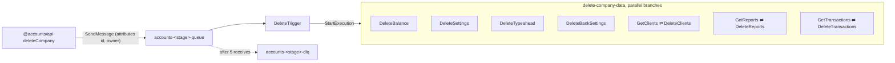

# Accounts queue architecture

## Purpose

`@accounts/queue` cleans up a deleted company's data. When a user deletes a company, `@accounts/api` removes the company item and sends a message to this stack's SQS queue. A trigger Lambda starts a Step Functions state machine that deletes the company's remaining items from the application table. It owns the `accounts-<stage>-queue` stack. See the [repository architecture](../../../../docs/architecture.md) for the wider picture.

## Layout

| Path                             | Contents                                                        |
| -------------------------------- | --------------------------------------------------------------- |
| `serverless.yml`                 | Queue, dead-letter queue, alarm, functions, state machine, IAM. |
| `src/triggers/delete.ts`         | SQS consumer that starts the state machine.                     |
| `src/handlers/delete-record.ts`  | Deletes one item by `__typename` and company `id`.              |
| `src/handlers/get-records.ts`    | Finds the IDs of a company's items of one type.                 |
| `src/handlers/delete-records.ts` | Batch-deletes one chunk of those IDs.                           |
| `src/shared/chunk.ts`            | Splits an array into fixed-size chunks.                         |
| `**/__tests__/`                  | Vitest tests next to each module.                               |

## Flow



The state machine `accounts-<stage>-delete-company-data` runs seven branches in parallel. Single-item types are deleted in one step. Collections loop: `Get*` returns up to 25 IDs; if it returns `complete: false`, `Delete*` deletes them and control returns to `Get*` until it returns nothing. `Get*` reads one page of the eventually consistent `__typename-data-index` without following `LastEvaluatedKey`, so an empty result does not prove every item is gone.

## Message shape

The API sends a message with body `Delete company <id>` and two string message attributes:

| Attribute | Value       |
| --------- | ----------- |
| `id`      | Company ID. |
| `owner`   | User `sub`. |

The trigger reads only the attributes; the body is ignored.

## Components

All handlers are wrapped with Sentry `wrapHandler` (tracing and profiling on). Every function gets `TABLE` (application table), `SENTRY_DSN` and `SENTRY_ENVIRONMENT` (the stage).

| Function                                                                   | Handler                   | Extra env vars                                                  | Input                            | Effect and output                                                                                                                                                                                                                                                   |
| -------------------------------------------------------------------------- | ------------------------- | --------------------------------------------------------------- | -------------------------------- | ------------------------------------------------------------------------------------------------------------------------------------------------------------------------------------------------------------------------------------------------------------------- |
| `DeleteTrigger`                                                            | `triggers/delete`         | `STATE_MACHINE_ARN`                                             | SQS batch                        | For each record with both `id` and `owner` attributes, starts an execution with input `{ id, owner }`. Records missing either are silently acknowledged. Returns `batchItemFailures` for records whose `StartExecution` failed, and reports each failure to Sentry. |
| `DeleteBalance`, `DeleteSettings`, `DeleteTypeahead`, `DeleteBankSettings` | `handlers/delete-record`  | `TYPENAME` = `Balance`, `Settings`, `Typeahead`, `BankSettings` | `{ id, owner }`                  | `DeleteItem` on key `{ __typename: TYPENAME, id }` with condition `owner = :owner`. Returns `{ complete: true }`. A missing item or different owner fails the condition and the branch.                                                                             |
| `GetClients`, `GetTransactions`, `GetReports`                              | `handlers/get-records`    | `TYPENAME` = `Client`, `Transaction`, `Report`                  | `{ id, owner }`                  | Queries `__typename-data-index` for `__typename = TYPENAME AND begins_with(data, '<owner>:<id>')`, filtered on `owner`, `Limit: 25`, projecting `id`. Returns `{ complete: false, count, current: 0, id, items: string[][], owner }` or `{ complete: true }`.       |
| `DeleteClients`, `DeleteTransactions`, `DeleteReports`                     | `handlers/delete-records` | Same `TYPENAME` as the matching `Get*`                          | `{ count, current, items, ... }` | `BatchWriteItem` deleting `items[current]` by `{ __typename, id }`. Returns the input with `current + 1` and `complete: current === count - 1`.                                                                                                                     |

The single-record handlers use the company `id` as the item `id`: these types are stored with the company ID as their key.

## Data

Items deleted from the application table, by `__typename`: `Balance`, `Settings`, `Typeahead`, `BankSettings` (one each, keyed by company `id`), and every `Client`, `Transaction` and `Report` whose `data` starts with `<owner>:<companyId>`.

Deleting items fires the application table stream, so stream consumers in other services (for example attachment clean-up in `@accounts/data`) react to these deletions.

## Infrastructure

Stack `accounts-<stage>-queue`, region `eu-west-1` by default, Node.js 24, bundled with esbuild (`@sentry/profiling-node` external). Log retention is 30 days.

| Resource                                                                                  | Detail                                                                                                                                                                                                    |
| ----------------------------------------------------------------------------------------- | --------------------------------------------------------------------------------------------------------------------------------------------------------------------------------------------------------- |
| `AccountsQueue` (`accounts-<stage>-queue`)                                                | Standard queue. Redrive to the DLQ after 5 receives.                                                                                                                                                      |
| `AccountsDeadLetterQueue` (`accounts-<stage>-dlq`)                                        | Retains messages for 14 days.                                                                                                                                                                             |
| `AccountsDeadLetterQueueAlarm` (`accounts-<stage>-company-deletion-dlq-messages-visible`) | Fires when at least one message is visible in the DLQ (1-minute maximum), missing data not breaching. Its action invokes the `ReportSchedulingAlarm` Lambda in `@accounts/data`, which reports to Sentry. |
| State machine `accounts-<stage>-delete-company-data`                                      | As described above.                                                                                                                                                                                       |

| Imports                                       | Used for         |
| --------------------------------------------- | ---------------- |
| `<stage>-AccountsApplicationTable` / `...Arn` | `TABLE` and IAM. |

| Exports                    | Value                                                                         |
| -------------------------- | ----------------------------------------------------------------------------- |
| `<stage>-AccountsQueueArn` | Queue ARN. `@accounts/api` grants itself `SendMessage` on it.                 |
| `<stage>-AccountsQueueUrl` | Queue path `/<account>/<queue name>`, used by the API's SQS HTTP data source. |

IAM, in plain terms:

- The worker role can batch-write, delete, get and query items in the application table and its `__typename-data-index`, and write logs.
- The trigger role can start executions of this stack's state machine, receive, delete and inspect messages on the main queue, and write logs.

## Failure handling and observability

- The trigger uses `ReportBatchItemFailures`, so only failed records return to the queue. After 5 receives they move to the DLQ and the alarm fires.
- Once an execution has started, the message is acknowledged. Step failures inside the state machine are not retried (no `Retry` or `Catch`) and do not reach the DLQ; check Step Functions execution history and Sentry.
- `delete-records` ignores `UnprocessedItems` from `BatchWriteItem`. Any unprocessed IDs are found again by the next `Get*` call, because the loop always re-queries.
- `delete-record` throws if the item does not exist (conditional check), which fails that branch and the execution.

## Testing

Tests sit in `__tests__` folders next to the code (files have no `.test` suffix; Vitest includes everything under `__tests__`). AWS SDK clients are stubbed with `aws-sdk-client-mock`. Run one file from the repository root:

```sh
yarn workspace @accounts/queue exec vitest run src/triggers/__tests__/delete.ts
```

## Making changes

- Adding a company-owned item type means adding functions and a branch to the state machine in `serverless.yml`; the handlers are generic and configured by `TYPENAME`.
- The message attributes are set by `@accounts/api`'s `queueCompanyDelete` request template (`api/mapping-templates/company/deleteCompany/`). Keep them in sync.
- Deploy after `@accounts/data`. `@accounts/api` imports the queue exports, so deploy the API after this stack, and do not remove the exports while it uses them.
- The DLQ alarm targets the `ReportSchedulingAlarm` function in `accounts-data-<stage>` by name.
- Check the resolved configuration without deploying: `SENTRY_DSN= yarn workspace @accounts/queue exec serverless print --stage local`.
