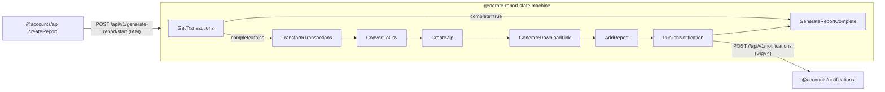

# Accounts reports architecture

## Purpose

`@accounts/reports` builds a downloadable ZIP of a company's transactions and attachments for one financial year. It owns the `accounts-<stage>-reports` stack: an IAM-authenticated REST endpoint that starts a Step Functions state machine, the Lambdas that run each step, and a short-lived report bucket. `@accounts/api` starts it from the `createReport` mutation, and it tells the user the report is ready through `@accounts/notifications`. See the [repository architecture](../../../../docs/architecture.md) for how the Accounts services fit together.

## Layout

| Path                     | Contents                                                                     |
| ------------------------ | ---------------------------------------------------------------------------- |
| `serverless.yml`         | Functions, the `generate-report` state machine, report bucket, IAM, outputs. |
| `src/handlers/`          | One Lambda handler per state machine step.                                   |
| `src/handlers/__tests__` | Vitest tests, one file per handler.                                          |
| `src/shared/archive.ts`  | Streams the CSV and attachments into a ZIP uploaded to S3.                   |
| `src/shared/`            | Small helpers: `padNumber`, `slug` and the `Status` enum.                    |
| `src/setupTests.ts`      | Vitest setup: AWS SDK matchers and module mocks.                             |
| `__mocks__/`             | Manual mocks for `archiver`, `json-2-csv`, `uuid` and `node-logger`.         |

## Flow



The state machine is `accounts-<stage>-generate-report`. Each step's output is the next step's input. If `GetTransactions` finds no transactions it returns `{ complete: true }` and the execution ends without a report or notification.

The API's request template sends this body to the start endpoint:

```json
{
  "companyId": "...",
  "currency": "£",
  "owner": "<user sub>",
  "status": "confirmed",
  "year": 2024,
  "yearEnd": { "day": 4, "month": 3 }
}
```

## Components

Every handler is wrapped with Sentry `wrapHandler`, validates its input with a Yup schema (`abortEarly`, `stripUnknown`), and throws on a missing env var or invalid input. A thrown error fails the step and, except for `CreateZip`, the execution.

| Step / function                                     | Input                                                                                                                                | Reads / writes                                                                                                                                                                                                                                | Output                                                                           | Env vars                                                                  |
| --------------------------------------------------- | ------------------------------------------------------------------------------------------------------------------------------------ | --------------------------------------------------------------------------------------------------------------------------------------------------------------------------------------------------------------------------------------------- | -------------------------------------------------------------------------------- | ------------------------------------------------------------------------- |
| `GetTransactions` / `GetTransactionsReport`         | `companyId`, `currency`, `owner`, `status` (`confirmed`/`pending`), `year`, `yearEnd { day ≤ 31, month ≤ 11 }`                       | Queries `__typename-data-index` for `Transaction` items whose `data` is between `<owner>:<companyId>:<status>:<year>-<month+1>-<day+1>T00:00:00Z` and `<owner>:<companyId>:<status>:<year+1>-<month+1>-<day>T23:59:59Z`, filtered on `owner`. | `{ companyId, complete: false, currency, items, owner }` or `{ complete: true }` | `TABLE`                                                                   |
| `TransformTransactions`                             | `companyId`, `currency`, `owner`, `items[]` (`amount`, `attachment?`, `category`, `date`, `description`, `id` (UUID), `name`, `vat`) | None.                                                                                                                                                                                                                                         | `{ attachments[], companyId, csv[], owner }`                                     | None                                                                      |
| `ConvertToCsv`                                      | `attachments[]`, `companyId`, `csv[]`, `owner`                                                                                       | None. Uses `json-2-csv` with `checkSchemaDifferences`.                                                                                                                                                                                        | `{ attachments, companyId, csv: string, owner }`                                 | None                                                                      |
| `CreateZip`                                         | `attachments[] { key, path }`, `companyId`, `csv`, `owner`                                                                           | Reads each attachment from the storage download bucket; writes `<owner>/<companyId>/<uuid>.zip` to the report bucket.                                                                                                                         | `{ companyId, key, owner }`                                                      | `DESTINATION_BUCKET`, `ORIGIN_BUCKET`                                     |
| `GenerateDownloadLink`                              | `companyId`, `key`, `owner`                                                                                                          | Presigns a `getObject` URL on the report bucket, valid for 86400 seconds.                                                                                                                                                                     | `{ companyId, downloadUrl, key, owner }`                                         | `BUCKET`                                                                  |
| `AddReport`                                         | `companyId`, `downloadUrl`, `key`, `owner`                                                                                           | Puts a `Report` item in the application table.                                                                                                                                                                                                | `{ owner, payload: { createdAt, downloadUrl, id, ttl } }`                        | `TABLE`                                                                   |
| `PublishNotification` / `PublishNotificationReport` | `owner`, `payload`                                                                                                                   | SigV4-signed `POST` (via `aws4fetch`, service `execute-api`) to `<ENDPOINT>/<STAGE>/api/v1/notifications`. Throws `Notification request failed` on a non-2xx response.                                                                        | `{ complete: true }`                                                             | `ENDPOINT`, `STAGE`, and the Lambda's AWS credential and region variables |

All functions also receive `SENTRY_DSN`, and `SENTRY_ENVIRONMENT` (the stage) from the provider.

### Transform details

- Transactions are sorted by date, oldest first.
- Each CSV row has columns `Date` (`dd/LL/yyyy`), `Category`, `Name`, `Description`, `In` and `Out`. A non-negative `amount` goes in `In` and a negative one in `Out` as an absolute value; the other column is `<currency>0.00`. Amounts use two decimal places with the currency symbol prefixed.
- Only transactions with an `attachment` produce an attachment entry. Its `key` is `<owner>/<attachment>` in the storage download bucket, and its `path` in the ZIP is `report/assets/<yyyy>/<MMMM>/<dd>/<slug(name)>-<slug(description)>-<id><ext>`. `slug` lower-cases and replaces whitespace with `-`.

### Archive

`src/shared/archive.ts` creates a ZIP with `archiver`, piped through a `PassThrough` into a multipart upload from `@motech-development/s3-file-operations` (`application/zip`). The CSV goes in at `report/accounts.csv`. All attachments are downloaded in parallel and buffered in memory before being appended, so memory use grows with the total attachment size. `archiver.append` is wrapped to feed each entry as a `Readable`, a workaround for Node 18 and later.

## Data

### `Report` item (written by `AddReport`)

| Field         | Value                                     |
| ------------- | ----------------------------------------- |
| `__typename`  | `Report`                                  |
| `id`          | New UUID.                                 |
| `owner`       | User `sub`.                               |
| `data`        | `<owner>:<companyId>:<createdAt>`         |
| `createdAt`   | UTC ISO timestamp.                        |
| `downloadUrl` | Presigned URL.                            |
| `key`         | Report bucket key.                        |
| `ttl`         | Epoch seconds, one day after `createdAt`. |

### Notification request

```json
{
  "message": "REPORT_READY_TO_DOWNLOAD",
  "owner": "<user sub>",
  "payload": "createdAt=...&downloadUrl=...&id=...&ttl=..."
}
```

`payload` is the `AddReport` payload serialised with `qs.stringify`. The client parses it as a query string when the notification arrives.

### S3

| Bucket                                             | Key layout                       | Notes                                                                                                  |
| -------------------------------------------------- | -------------------------------- | ------------------------------------------------------------------------------------------------------ |
| Report bucket `accounts-<stage>-reports`           | `<owner>/<companyId>/<uuid>.zip` | Created here. Lifecycle rule expires objects after 1 day. CORS allows `GET` and `PUT` from any origin. |
| Storage download bucket (from `@accounts/storage`) | `<owner>/<attachment path>`      | Read only.                                                                                             |

## Infrastructure

Stack `accounts-<stage>-reports`, region `eu-west-1` by default, Node.js 24, bundled per function with esbuild (`@sentry/profiling-node` external). Log retention is 30 days. The `serverless-prune-plugin` keeps one previous version.

| Imports (CloudFormation export)               | Used for                      |
| --------------------------------------------- | ----------------------------- |
| `<stage>-AccountsApplicationTable` / `...Arn` | `TABLE` and IAM.              |
| `<stage>-StorageDownloadBucket` / `...Arn`    | `ORIGIN_BUCKET` and IAM.      |
| `<stage>-NotificationsApiEndpoint`            | `ENDPOINT`.                   |
| `<stage>-NotificationsApiArn`                 | IAM for `execute-api:Invoke`. |

| Exports                              | Value                                       |
| ------------------------------------ | ------------------------------------------- |
| `<stage>-AccountsReportsApiEndpoint` | Base URL of this stack's REST API.          |
| `<stage>-AccountsReportsApiArn`      | `execute-api` ARN pattern for the REST API. |

All functions share one role, which can:

- query the application table's `__typename-data-index` and put items in the table;
- read and write objects in the report bucket;
- read objects in the storage download bucket;
- invoke the notifications API;
- write CloudWatch Logs.

The start endpoint uses `aws_iam` authorization, so only callers with `execute-api:Invoke` on the exported ARN (the AppSync data source in `@accounts/api`) can start a report.

## Failure handling and observability

- Errors are reported to Sentry by `wrapHandler`, with tracing and profiling enabled (`tracesSampleRate: 1`). Sentry's environment is the stage.
- Only `CreateZip` has a Step Functions retry: up to 3 attempts on any error, 5 seconds apart with a backoff rate of 2. `CreateZip` has a 300-second timeout; the others use the Serverless default.
- Any other failed step fails the execution. There is no catch state, dead-letter queue or alarm, so the user gets no notification. Look at the execution history in Step Functions and the Sentry issue.
- `GetTransactions` reads a single query page and does not follow `LastEvaluatedKey`, so a year whose matching items exceed one DynamoDB page (1 MB) is truncated.

## Testing

Tests live in `src/handlers/__tests__/<handler>.test.ts` and run in Node with Vitest globals. `src/setupTests.ts` loads `aws-sdk-client-mock-vitest` matchers and mocks `@motech-development/node-logger`, `archiver`, `json-2-csv` and `uuid` (see `__mocks__/`). AWS SDK calls are stubbed with `aws-sdk-client-mock`. Files run serially (`--no-file-parallelism`).

Run one file from the repository root:

```sh
yarn workspace @accounts/reports exec vitest run src/handlers/__tests__/create-zip.test.ts
```

## Making changes

- The state machine passes each step's whole output to the next, and Yup strips unknown keys. Adding a field means returning it from every step in between.
- `TransformTransactions` imports its output type from `convert-to-csv.ts`; keep the CSV row schema in both in sync.
- The input shape is set by `@accounts/api`'s `createReport` request template (`api/mapping-templates/reports/createReport/`). Change both together.
- The notification `message` (`REPORT_READY_TO_DOWNLOAD`) and query-string `payload` are read by `@accounts/client` (`src/components/ApolloClient.tsx` and its translations). Change them together.
- Deploy after `@accounts/data`, `@accounts/notifications` and `@accounts/storage`, whose exports this stack imports. `@accounts/api` imports this stack's exports, so a removed export breaks it.
- Check the resolved configuration without deploying: `SENTRY_DSN= yarn workspace @accounts/reports exec serverless print --stage local`.
