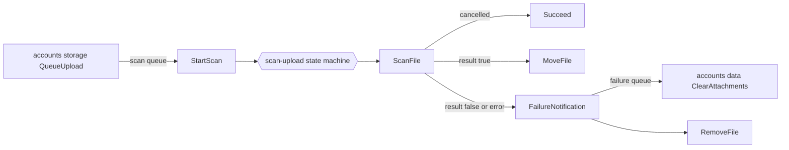

# Anti-virus architecture

## Purpose

`@core/anti-virus` (stack `anti-virus-<stage>`) scans every file uploaded to Accounts storage with ClamAV before anyone can download it. Clean files move from the upload (quarantine) bucket to the download bucket; infected files, and files whose scan fails, are reported to Accounts and removed. It also owns the attachment lifecycle table that `@accounts/storage` and the `@motech-development/s3-file-operations` package use to track uploads. See the [repository architecture](../../../../docs/architecture.md#attachments) for the end-to-end attachment flow.

## Layout

| Path                              | Contents                                                                                         |
| --------------------------------- | ------------------------------------------------------------------------------------------------ |
| `serverless.yml`                  | Lambdas, the `scan-upload` state machine, queues, buckets, the attachment table and IAM.         |
| `src/handlers/`                   | One file per Lambda.                                                                             |
| `src/shared/clam-av.ts`           | Runs the `clamscan` and `freshclam` binaries.                                                    |
| `src/shared/virus-definitions.ts` | The definition files kept in the definitions bucket: `bytecode.cvd`, `daily.cvd`, `main.cvd`.    |
| `src/freshclam.conf`              | `freshclam` configuration packaged with `UpdateDefinitions`.                                     |
| `scripts/build.sh`                | Builds ClamAV in an Amazon Linux 2023 container and copies the binaries and libraries to `bin/`. |
| `scripts/cache.sh`                | Validates or writes the `bin/` cache manifest.                                                   |
| `scripts/clean.sh`                | Removes the builder container, `clamav/` and `bin/`.                                             |
| `build-inputs.env`                | Pinned build inputs (image, ClamAV version and checksum, packages, CMake options).               |
| `webpack.config.js`               | Bundles handlers; adds the binaries only to `ScanFile` and `UpdateDefinitions`.                  |
| `src/__tests__/package.ts`        | Checks the packaged output.                                                                      |

## Scan flow



State machine `anti-virus-<stage>-scan-upload`:

1. `ScanFile`. Any error is caught and routed to `FailureNotification` with the error at `$.error`.
2. `CheckCancellation`. If `$.cancelled` is present the execution ends successfully.
3. `ProcessResult`. `$.result == true` goes to `MoveFile`; anything else goes to `FailureNotification`.
4. `MoveFile` retries on all errors with the Step Functions default policy (3 retries), then ends.
5. `FailureNotification` then `RemoveFile`, then ends.

## Components

All handlers are wrapped with Sentry (`init` + `wrapHandler`, tracing and profiling at a sample rate of 1). Every function receives `ATTACHMENT_TABLE`, `BUCKET` (definitions bucket), `LD_LIBRARY_PATH`, `SENTRY_ENVIRONMENT` and its own `SENTRY_DSN`.

Execution input is `{ from, key, to, managed? }`: `from` is the upload bucket, `to` the download bucket, `key` the S3 object key as delivered in the S3 event (URL-encoded, so the managed-lifecycle calls decode it with `decodeURIComponent`, which leaves `+` as `+` rather than a space). A file is _managed_ when the input says so or the object has metadata `attachment-lifecycle: v1` (set by `@accounts/storage` `signed-upload`).

| Function              | Trigger                                     | Behaviour                                                                                                                                                                                                                                                                                                                                                                                                                     | Extra env vars      |
| --------------------- | ------------------------------------------- | ----------------------------------------------------------------------------------------------------------------------------------------------------------------------------------------------------------------------------------------------------------------------------------------------------------------------------------------------------------------------------------------------------------------------------- | ------------------- |
| `StartScan`           | Scan queue (SQS, `ReportBatchItemFailures`) | Reads message attributes `from`, `key`, `to` and starts one execution per record. Records whose `StartExecution` fails are returned as batch item failures and sent to Sentry; the rest succeed.                                                                                                                                                                                                                              | `STATE_MACHINE_ARN` |
| `ScanFile`            | State machine (2048 MB, 300 s)              | Reads the object head. Missing object: returns `{ ...event, cancelled: true }`. Managed file whose lifecycle record is not `pending`: deletes the upload and cancels. Otherwise downloads the file to `/tmp/downloads`, downloads the definitions from `BUCKET` on a cold `/tmp`, runs `clamscan` and returns `{ from, key, managed?, result, to }`. `result` is `false` when `clamscan` exits non-zero (infected or failed). | `BUCKET`            |
| `MoveFile`            | State machine (900 s)                       | Managed: `moveStagedFile` (completes the lifecycle transfer and marks it `ready`). Otherwise `moveFile` from `from` to `to`.                                                                                                                                                                                                                                                                                                  | none                |
| `FailureNotification` | State machine                               | Reads the object head; returns early if missing, or if managed and no longer `pending`. Otherwise sends a message to the failure queue (body `<key> has failed virus scan`, attributes `key`, `source`, `metadata` as JSON without `attachment-lifecycle`). When the metadata has no `id` the message is delayed 60 s. Throws if a managed file has no `to`.                                                                  | `QUEUE_URL`         |
| `RemoveFile`          | State machine                               | Managed: `deleteStagedFile(from, to, key, { pendingOnly: true })`. Otherwise `deleteFile(from, key)`.                                                                                                                                                                                                                                                                                                                         | none                |
| `UpdateDefinitions`   | Schedule, `rate(1 day)` (2048 MB, 300 s)    | Clears `/tmp`, runs `freshclam` and uploads the three `.cvd` files to `BUCKET`. Any failure is logged and rethrown as `Unable to update virus definitions`.                                                                                                                                                                                                                                                                   | `BUCKET`            |
| `CleanupAttachments`  | Schedule, `rate(1 day)` (900 s)             | Calls `cleanupExpiredStagedFiles`, which pages the `PendingExpiry` index for expired `pending` and `deleting` records and removes the abandoned files.                                                                                                                                                                                                                                                                        | none                |

## Data

**Attachment table** `anti-virus-<stage>-attachments` (on-demand). Partition key `path`; GSI `PendingExpiry` on `state` + `expiresAt` (number, epoch seconds). Records are written by `@motech-development/s3-file-operations` with `state` of `pending`, `ready` or `deleting`; `ready` records have no `expiresAt`.

**Definitions bucket** `anti-virus-<stage>-definitions`: `bytecode.cvd`, `daily.cvd`, `main.cvd` at the root.

**Scan queue message** (from `@accounts/storage`): body `Upload <key>`, string attributes `from`, `key`, `to`.

**Failure queue message** (to `@accounts/data` `ClearAttachments`): body `<key> has failed virus scan`, string attributes `key`, `source` and optionally `metadata` (JSON with `typename` and optional `id`).

Buckets it reads and writes but does not own: `accounts-<stage>-uploads` and `accounts-<stage>-downloads`.

## Infrastructure

Resources: the attachment table, the definitions bucket, the scan queue `anti-virus-<stage>-queue` and failure queue `anti-virus-<stage>-failure-queue` (the scan queue redrives to a DLQ after 5 receives; the failure queue has a 60 s visibility timeout and redrives after 15 receives; both DLQs keep messages 14 days), two DLQ alarms, the state machine and two IAM roles. Uses the `anti-virus-deployment-bucket` deployment bucket.

Exports:

| Export                             | Value                 |
| ---------------------------------- | --------------------- |
| `<stage>-AttachmentTable`          | Attachment table name |
| `<stage>-AttachmentTableArn`       | Attachment table ARN  |
| `<stage>-AntiVirusQueueArn`        | Scan queue ARN        |
| `<stage>-AntiVirusQueueUrl`        | Scan queue URL        |
| `<stage>-AntiVirusFailureQueueArn` | Failure queue ARN     |

It imports nothing, so it deploys first. `@accounts/storage` and `@accounts/data` depend on it.

IAM in plain terms:

- The shared Lambda role can read, tag-read and delete objects in the Accounts upload bucket; read, write, tag, delete and abort multipart uploads in the download bucket; list both buckets; read and write the definitions bucket; get, update, delete and query the attachment table and its `PendingExpiry` index; send to the failure queue; and write logs.
- The `StartScan` role can start executions of the scan state machine, consume the scan queue and write logs.

## Failure handling and observability

- Sentry captures unhandled errors in every handler, plus each failed record in `StartScan`. `SENTRY_ENVIRONMENT` is the stage.
- The scan queue redrives to its DLQ after 5 receives and the failure queue after 15, because `ClearAttachments` retries failure messages each minute until the transaction is saved. The alarms `accounts-<stage>-anti-virus-dlq-messages-visible` and `accounts-<stage>-anti-virus-failure-dlq-messages-visible` fire on one visible message and invoke `accounts-data-<stage>-ReportSchedulingAlarm`, which reports to Sentry. The alarm names use the `accounts-<stage>-` prefix because that reporter only accepts names in that form.
- A scan error takes the failure branch, which notifies the user and removes the upload if those steps succeed.
- `MoveFile` retries all errors with the Step Functions defaults (up to 3 retries with backoff); a final failure fails the execution and the file stays in quarantine until lifecycle cleanup.
- Log retention is 30 days.

## Building ClamAV

`predeploy` runs `scripts/build.sh`, which needs Docker. It sources `build-inputs.env` and first asks `scripts/cache.sh validate` whether `bin/` matches a manifest keyed on the hashes of `build-inputs.env`, `build.sh` and `cache.sh`. If not, it builds ClamAV from source in the pinned Amazon Linux 2023 image, copies `clamscan`, `freshclam` and their shared libraries into `bin/`, and writes a new manifest. Webpack copies `bin/` (or `ANTI_VIRUS_BINARY_DIRECTORY`) into the `ScanFile` and `UpdateDefinitions` packages only and sets executable permissions; `LD_LIBRARY_PATH` includes `/var/task` so the bundled libraries load.

## Testing

Vitest, with tests in `__tests__` folders next to the code. `src/setupTests.ts` loads `aws-sdk-client-mock-vitest` matchers and mocks `@motech-development/node-logger`. AWS clients are mocked with `aws-sdk-client-mock`; `s3-file-operations` and `child_process` are mocked per test. `src/__tests__/package.ts` checks the packaged output. Files run serially (`--no-file-parallelism`).

Run one file:

```sh
yarn workspace @core/anti-virus vitest run src/handlers/__tests__/scan-files.ts
```

## Making changes

- Changing anything in `build-inputs.env`, `scripts/build.sh` or `scripts/cache.sh` invalidates the binary cache and forces a Docker rebuild on the next deploy.
- The Accounts bucket names (`accounts-<stage>-uploads`, `accounts-<stage>-downloads`) are hard-coded in IAM, and the alarm action names `accounts-data-<stage>-ReportSchedulingAlarm` by convention. Keep them in step with `@accounts/storage` and `@accounts/data`.
- The failure queue message shape is consumed by `@accounts/data` `clear-attachments`; change both together.
- The attachment table is shared with `@accounts/storage` through the `<stage>-AttachmentTable` exports; removing or renaming it breaks that stack.
- Handlers that touch the managed lifecycle must decode the S3 key before using it as a lifecycle path.
