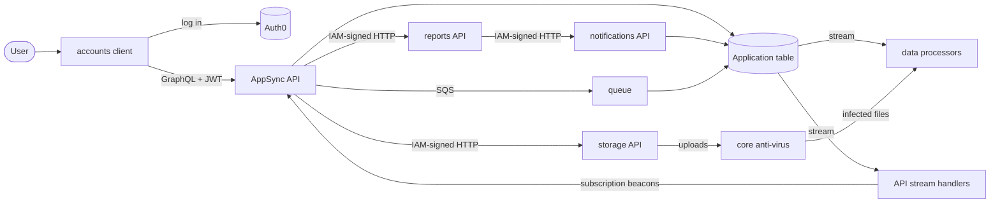
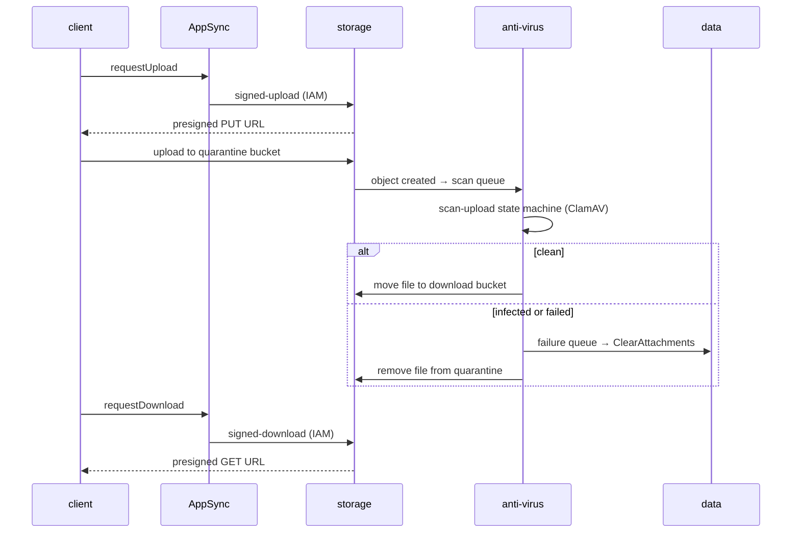
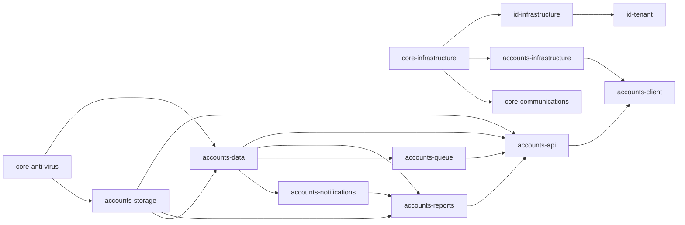

# Architecture

How the applications and packages in this monorepo fit together. Each workspace's README covers how to work on it; this page covers how they connect.

## Repository layout

| Path                  | Contents                                                                                        |
| --------------------- | ----------------------------------------------------------------------------------------------- |
| `applications/<app>/` | Deployable workspaces, grouped by product: `accounts`, `core` and `id`.                         |
| `packages/`           | Shared libraries and tooling config, versioned and released independently.                      |
| `.github/`            | Quality gates, the Deployment Catalog, generated delivery workflows and Platform Delivery docs. |
| `docs/`               | Repository-wide ADRs and agent guidance.                                                        |

Everything is a Yarn 4 workspace (`applications/*/*` and `packages/*`). Applications mostly depend on packages through `workspace:*` ranges, so a package must be built before a consumer can use it. The exception is `@motech-development/breeze-ui`: both clients pin the published `2.4.0` from npm, so local Breeze UI changes do not reach them. `yarn package` builds every package in dependency order.

## Technology

- **Runtime**: Node.js (version in `.nvmrc`) on AWS Lambda. Each service sets its default region in its `serverless.yml`: most use `eu-west-1`, while the infrastructure stacks, the client hosting stacks and `@core/comms` use `us-east-1`.
- **Infrastructure as code**: Serverless Framework v3 (the `osls` distribution) generating CloudFormation for most services; AWS CDK for `@accounts/web` and `@accounts/data-restore`.
- **Data**: DynamoDB with streams, S3, SQS, Step Functions and EventBridge Scheduler.
- **API**: AWS AppSync (GraphQL) with VTL resolvers and a few Lambda resolvers.
- **Frontends**: React single-page apps built with Vite.
- **Identity**: Auth0, with a custom login page and email templates.
- **Observability**: Sentry for errors and alarms, AWS X-Ray on AppSync.
- **Quality**: Vitest, Playwright, ESLint, Prettier, TypeScript, SonarCloud and Chromatic.

## Products

### Core

Shared services used by more than one product.

| Workspace              | Stack                             | Purpose                                                                              |
| ---------------------- | --------------------------------- | ------------------------------------------------------------------------------------ |
| `@core/infrastructure` | `platform-<stage>-infrastructure` | The public DNS hosted zone, mail records and a wildcard TLS certificate.             |
| `@core/comms`          | `platform-<stage>-comms`          | Verifies the domain with Amazon SES (DKIM, SPF and DMARC) through a custom resource. |
| `@core/anti-virus`     | `anti-virus-<stage>`              | Scans uploaded files with ClamAV and releases or rejects them.                       |

`@core/infrastructure` exports `HostedZoneId` and `Certificate`, which every stack that serves a subdomain imports.

### Accounts

A bookkeeping application for recording a company's transactions. Its domain language is in [`applications/accounts/GLOSSARY.md`](../applications/accounts/GLOSSARY.md) and its decisions in [`applications/accounts/docs/adr/`](../applications/accounts/docs/adr/).

| Workspace                  | Stack                             | Purpose                                                                                          |
| -------------------------- | --------------------------------- | ------------------------------------------------------------------------------------------------ |
| `@accounts/client`         | none (publishes into the hosting) | The React web app users work in.                                                                 |
| `@accounts/infrastructure` | `accounts-<stage>-infrastructure` | S3 and CloudFront hosting for the client.                                                        |
| `@accounts/api`            | `accounts-<stage>-api`            | The AppSync GraphQL API the client talks to.                                                     |
| `@accounts/data`           | `accounts-<stage>-data`           | The application table and the stream processors that keep derived data up to date.               |
| `@accounts/storage`        | `accounts-<stage>-storage`        | Attachment upload and download buckets, presigned URLs and file deletion.                        |
| `@accounts/reports`        | `accounts-<stage>-reports`        | Builds a downloadable financial-year export.                                                     |
| `@accounts/notifications`  | `accounts-<stage>-notifications`  | Records in-app notifications.                                                                    |
| `@accounts/queue`          | `accounts-<stage>-queue`          | Cleans up a deleted company's remaining data.                                                    |
| `@accounts/web`            | `accounts-web-hosting` (CDK)      | A placeholder for the Accounts rebuild on retained Amplify hosting. Outside automated delivery.  |
| `@accounts/data-restore`   | `DataRestoreStack` (CDK)          | A hand-deployed runbook tool for rolling the application table back. Outside automated delivery. |

### ID

Identity for all products, built on Auth0. These workspaces are sensitive: see `AGENTS.md` before changing anything here.

| Workspace            | Purpose                                                                         |
| -------------------- | ------------------------------------------------------------------------------- |
| `@id/tenant`         | The Auth0 tenant configuration and Actions, deployed with the Auth0 Deploy CLI. |
| `@id/client`         | The custom universal login page (log in, sign up, password reset).              |
| `@id/emails`         | Pug sources for the tenant's transactional email templates.                     |
| `@id/infrastructure` | S3 and CloudFront hosting for the login page.                                   |

ID deploys to Develop and production, never to Preview Environments, which would all share one Auth0 tenant. Two Deployment Units do this: `id-infrastructure` deploys the hosting stack, and `id-tenant` builds the client and emails, uploads the client and imports the Auth0 tenant. The upload empties the bucket first, so sign-in can fail briefly until the import finishes.

## How Accounts works



### Authentication

Users sign in with Auth0 through the client. AppSync trusts the Auth0 tenant as an OpenID Connect issuer, so every user request carries an Auth0 token. Resolvers scope reads and writes to the caller's identity (the **Accounts Owner ID** in the glossary). Backend Lambdas call AppSync with IAM authentication instead, which is how they publish subscription updates.

### The application table

`@accounts/data` owns one DynamoDB table, `accounts-<stage>-application`, keyed by `id` and `__typename`, with a `__typename-data-index` index for listing items of one type. Companies, clients, transactions, balances, settings, typeahead suggestions, reports and notifications all live in it. The table has point-in-time recovery and a stream of new and old images.

Most API resolvers read and write this table directly through VTL templates. Derived data is not written by the resolvers; stream consumers maintain it after each change:

| Consumer (workspace)   | Reacts to                                    | Does                                                                                                                                                                                                                |
| ---------------------- | -------------------------------------------- | ------------------------------------------------------------------------------------------------------------------------------------------------------------------------------------------------------------------- |
| `ProcessStream` (data) | Transaction changes                          | Records suggestions for forms, queues a deleted transaction's attachment for deletion and maintains each scheduled transaction's schedule.                                                                          |
| `PublishStream` (api)  | Transaction changes and notification inserts | Keeps company balances and VAT totals in step and publishes the balance to `onTransaction`, then publishes `onTransactionChange` and `onNotification`, so a saved transaction reaches clients after one stream hop. |

AWS recommends at most two readers per stream shard, so each stack has one consumer (see Accounts ADR 0004). Only `PublishStream` applies balance changes, and idempotent markers stop a retried record from being counted twice. Failed stream batches from both consumers are retained in S3 and reported through a dead-letter queue and alarms (see Accounts ADRs 0002, 0003 and 0004). `@accounts/data-restore` explains how these consumers are paused during a table restore.

### Scheduled transactions

A pending transaction can be scheduled to publish on its transaction date. `ProcessStream` maintains one EventBridge Scheduler schedule per transaction. When it fires, the schedule sends a message to the data stack's publication queue, and `PublishTransactions` confirms the transaction. The confirmation then flows through the stream consumers like any other change. See Accounts ADR 0001.

### Attachments



Files are uploaded straight to S3 with presigned URLs, never through the API. New uploads land in a quarantine bucket with a short expiry. `@core/anti-virus` scans each one and moves clean files to the download bucket. When a file is rejected, `@accounts/data` removes the attachment from its transaction. Anti-virus also refreshes its virus definitions daily and cleans up abandoned uploads.

Deleting a transaction, or calling the `deleteFile` mutation, sends the file to storage's delete queue, where `ProcessDelete` removes it.

### Reports

The `createReport` mutation starts the reports service's `generate-report` Step Functions state machine over an IAM-signed HTTP call. The machine reads the year's transactions in a single query without a continuation key, so a year larger than one DynamoDB page is truncated. It converts them to CSV, zips the CSV with the transactions' attachments, stores the archive in a report bucket that expires objects after a day, and creates a 24-hour download link. It then records the report in the application table and calls the notifications API, so the user receives an in-app notification through the `onNotification` subscription.

### Deleting a company

`deleteCompany` deletes the company item and sends a message to the Accounts queue. The queue's trigger starts the `delete-company-data` state machine, which deletes the company's balance, settings, typeahead, bank settings, clients, transactions and reports in parallel, paging through large collections until they are gone.

### Cross-stack wiring

Stacks share resources through CloudFormation exports named `<stage>-<Name>` and consume them with `!ImportValue`. The exception is `@core/infrastructure`, whose `Certificate` and `HostedZoneId` exports have no stage prefix. For example, `@accounts/data` exports the application table and stream ARNs, `@accounts/storage` exports its buckets and API endpoint, and `@core/anti-virus` exports its queues and attachment table. Because imports must exist at deploy time, stacks deploy in dependency order. That order is recorded in [`.github/delivery/catalog.json`](../.github/delivery/catalog.json):



To find every relationship:

```sh
rg -n 'ImportValue|Export' applications --glob 'serverless*.yml'
```

## Stages and environments

Every Serverless service takes a `--stage` (default `local`), and stack and resource names include it. The deployed stages are:

| Stage        | Environment                            | Deployed from                              |
| ------------ | -------------------------------------- | ------------------------------------------ |
| `pr-<n>`     | Preview Environment for a pull request | The pull request's head commit.            |
| `develop`    | Develop                                | Exact Release tags, after merge to `main`. |
| `production` | Production                             | The same Release tags as Develop.          |

Preview Environments include only the units that support previews; they reuse shared Develop resources read-only. Some units, such as DNS and client hosting, deploy to production only. Sentry environment names follow the same stage names.

## Build, release and delivery

1. **Pull request**: the Quality Assurance workflow runs formatting, lint, type checks, unit tests and builds. The preview workflow deploys a Preview Environment and runs the Accounts Playwright tests against it. Pull requests own all blocking quality gates.
2. **Merge to `main`**: the Release workflow runs `multi-semantic-release`, which versions each changed workspace from its Conventional Commits and creates a GitHub Release tagged `<workspace>@<version>`. Public packages are published to npm.
3. **Delivery**: Develop and production reconcile in parallel to the latest Release tags, deploying each Deployment Unit from its own exact tag and recording a GitHub Deployment.

Workflow job graphs are generated from the Deployment Catalog; never edit them directly. See [`.github/delivery/README.md`](../.github/delivery/README.md), the [Platform Delivery glossary](../.github/GLOSSARY.md) and [ADRs](../.github/docs/adr/), and [`docs/agents/platform-delivery.md`](agents/platform-delivery.md).

## Shared packages

| Package                                          | Used by                                             |
| ------------------------------------------------ | --------------------------------------------------- |
| `@motech-development/api-gateway-handler`        | API Gateway Lambdas (notifications, storage).       |
| `@motech-development/appsync-apollo`             | Accounts client.                                    |
| `@motech-development/auth`                       | Accounts client.                                    |
| `@motech-development/axios-hooks`                | Accounts and ID clients.                            |
| `@motech-development/breeze-ui`                  | Published UI library; the clients pin 2.x from npm. |
| `@motech-development/ga-web-vitals`              | Accounts and ID clients.                            |
| `@motech-development/node-logger`                | Backend Lambdas.                                    |
| `@motech-development/query-string-hook`          | `@motech-development/auth`.                         |
| `@motech-development/s3-file-operations`         | Anti-virus, reports and storage.                    |
| `@motech-development/serverless-outputs-env`     | Accounts API (writes the client's API settings).    |
| `@motech-development/webpack-conditional-plugin` | Anti-virus build.                                   |
| `@motech-development/webpack-permissions-plugin` | Anti-virus build.                                   |
| `@motech-development/eslint-config-motech-*`     | Every workspace's ESLint config.                    |
| `@motech-development/prettier-motech-config`     | Every workspace's Prettier config.                  |
| `@motech-development/semantic-release`           | Every workspace's release config.                   |
| `@motech-development/yarn-plugin-*`              | Yarn install hooks.                                 |

Each package's README documents its API.

## Secrets and configuration

Deployments read secrets such as the Sentry DSN, Auth0 settings and the production domain from environment variables supplied by GitHub Actions. Nothing secret is committed. For local checks, use placeholder values (for example `example.invalid` for domains) and the `local` stage; nothing is deployed unless you run a `deploy` script with AWS credentials.
