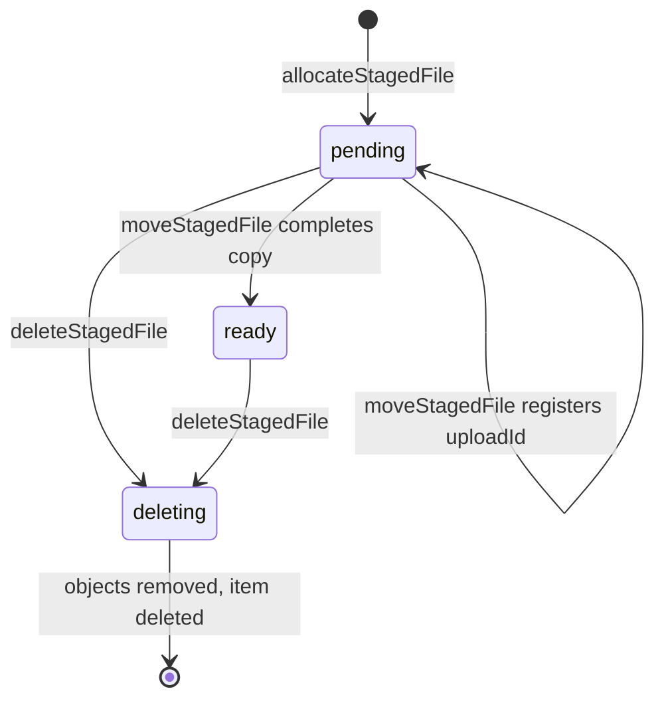

# S3 file operations architecture

## Purpose

Shared S3 helpers for Lambda handlers, plus a staged-file lifecycle that tracks a file moving from an untrusted upload bucket to a trusted bucket in DynamoDB, so the move survives retries, concurrent workers and deletions mid-transfer. `@accounts/reports` uses the plain helpers; `@accounts/storage` and `@core/anti-virus` use the lifecycle for attachments. See the [repository architecture](../../../docs/architecture.md).

## Layout

| Path                        | Contents                                                    |
| --------------------------- | ----------------------------------------------------------- |
| `src/s3-file-operations.ts` | Entry point: S3 helpers; re-exports the lifecycle functions |
| `src/file-lifecycle.ts`     | Staged-file lifecycle (DynamoDB + S3 multipart copy)        |
| `src/setupTests.ts`         | Registers `aws-sdk-client-mock-vitest` matchers             |
| `src/__tests__/`            | One test file per source file                               |

## API reference: S3 helpers

Every helper takes an optional `client: S3Client` as its last parameter, defaulting to a module-level `new S3Client({})`. Where noted, `key` is passed through `decodeURIComponent` first to undo the URL encoding of keys from S3 event notifications; it does not turn `+` into a space, so keys containing spaces need that replacement first. Write a literal `%` as `%25`; a bare `%` makes `decodeURIComponent` throw `URIError`. AWS SDK errors propagate unchanged.

| Export                                                             | Returns                            | Behaviour                                                                                                                                                                                            |
| ------------------------------------------------------------------ | ---------------------------------- | ---------------------------------------------------------------------------------------------------------------------------------------------------------------------------------------------------- |
| `createDirectory(name)`                                            | `Promise<boolean>`                 | Creates a local directory (non-recursive) if missing. Resolves `true` if it already existed.                                                                                                         |
| `createFile(to, key, body: string \| ReadStream, client?)`         | `Promise<void>`                    | `PutObject`. Key not decoded.                                                                                                                                                                        |
| `createSignedUrl(operation, bucket, key, expires, opts?, client?)` | `Promise<string>`                  | Presigned URL valid for `expires` seconds. `operation` is `'getObject'` or `'putObject'`; `opts` (`ContentType`, `Metadata`) applies to `putObject` only. Key not decoded.                           |
| `deleteFile(bucket, key, client?)`                                 | `Promise<void>`                    | `DeleteObject`. Key decoded.                                                                                                                                                                         |
| `downloadFileStream(bucket, key, client?)`                         | `Promise<Readable>`                | `GetObject` body. Throws `Unable to stream file` if the body is not a Node `Readable`. Key decoded.                                                                                                  |
| `downloadFile(bucket, key, to, client?)`                           | `Promise<string>`                  | Streams the object to `join(to, basename(key))` and resolves that path. Key decoded for the S3 request; the local file name uses the raw key.                                                        |
| `getFileData(bucket, key, client?)`                                | `Promise<HeadObjectCommandOutput>` | `HeadObject`. Key decoded.                                                                                                                                                                           |
| `moveFile(from, to, key, client?)`                                 | `Promise<void>`                    | `CopyObject` into `to` then `deleteFile` from `from`. Not atomic: a failed delete leaves both copies. Key decoded.                                                                                   |
| `removeFolder(bucket, prefix, client?)`                            | `Promise<void>`                    | Lists up to 1,000 objects under the prefix, deletes them in one `DeleteObjects`, recurses while the listing was truncated. Throws `Unable to delete <n> objects` on partial failure. Prefix decoded. |
| `uploader(bucket, key, body, contentType, client?)`                | `Upload`                           | Returns (does not start) an `@aws-sdk/lib-storage` multipart `Upload`; call `.done()`.                                                                                                               |

```ts
const path = await downloadFile(bucket, key, '/tmp');
await moveFile(fromBucket, toBucket, key);
```

## API reference: staged-file lifecycle

These functions use their own module-level `S3Client` and `DynamoDBDocumentClient` (no client parameter) and read the table name from `ATTACHMENT_TABLE`; each throws `No attachment table set` if it is unset. Keys are **not** decoded here; callers decode S3 event keys before calling.

### Data

One DynamoDB item per file (`IStagedFile`, exported as a type):

| Field               | Meaning                                                                             |
| ------------------- | ----------------------------------------------------------------------------------- |
| `path`              | Partition key: `<to bucket>/<key>`                                                  |
| `from`, `to`, `key` | Source bucket, destination bucket, object key                                       |
| `state`             | `pending` → `ready`, or `deleting`                                                  |
| `expiresAt`         | Epoch seconds. Set while `pending` or `deleting`; removed when `ready`              |
| `uploadId`          | Multipart upload ID registered for the copy into `to`                               |
| `token`             | Random UUID also written to the destination object's `attachment-transfer` metadata |
| `sourceETag`        | Source object's ETag at registration; the copy is conditional on it                 |
| `empty`             | Source was zero bytes (copied with `UploadPart` instead of `UploadPartCopy`)        |

`cleanupExpiredStagedFiles` queries a GSI named `PendingExpiry` (partition `state`, sort `expiresAt`). The table and index are defined in `applications/core/anti-virus/serverless.yml`.

### State machine



### `isMissingFile(error): boolean`

`true` if `error` is an `Error` named `NotFound` or `NoSuchKey`.

### `allocateStagedFile(from, to, key, uploadExpiresInSeconds, quarantineRetentionDays): Promise<void>`

Puts a `pending` item, conditional on `path` not existing (throws `ConditionalCheckFailedException` if it does). `expiresAt` = now + `uploadExpiresInSeconds`, plus `quarantineRetentionDays + 1` days, truncated to UTC midnight — matching the quarantine bucket's lifecycle expiry. Called by `@accounts/storage` when issuing an upload URL.

### `getStagedFile(to, key): Promise<IStagedFile | undefined>`

Strongly consistent `GetItem`.

### `moveStagedFile(from, to, key): Promise<void>`

Copies the object from `from` to `to` and deletes the source. Safe to retry and to run concurrently, provided a key is not reused while an earlier move or deletion of it can still run: `deleteStagedFile` removes the record unconditionally, so an overlapping deletion of the old key can remove a newly allocated file.

1. Read the item.
2. If `pending` with no `uploadId`, **register**: `HeadObject` the source (throws `Source has no ETag` if absent), `CreateMultipartUpload` in `to` copying the source's content headers and metadata plus `attachment-transfer: <token>`, then conditionally store `uploadId`, `token`, `sourceETag`, `empty` (condition: still `pending` and no `uploadId`). If that write fails, re-read: if the stored `uploadId` is ours, carry on; on a definite condition failure, abort our upload and continue with whatever is stored; on any other error, rethrow without aborting (the write may still have landed; S3 lifecycle cleans unregistered uploads).
3. If no item or `deleting`, call `deleteStagedFile` and return.
4. If `pending`, **complete**: skip the copy if the destination already carries our `token`; otherwise upload part 1 (`UploadPartCopy` with `CopySourceIfMatch: sourceETag`, or an empty `UploadPart` for zero-byte files) and `CompleteMultipartUpload`. If that throws but the destination now has our token, treat it as done. Then set `state = ready` and remove `expiresAt`, conditional on still `pending` with the same `uploadId`.
5. Delete the source object.

On any error in steps 2–5, re-read the item: if gone or `deleting`, run `deleteStagedFile`; if `ready` with the same `uploadId`, just delete the source; otherwise rethrow.

### `deleteStagedFile(from, to, key, options?): Promise<void>`

Marks the item `deleting` (with `expiresAt` = now, so a failed delete stays discoverable by cleanup), then aborts any registered multipart upload (ignoring `NoSuchUpload`), deletes the object from `to` and from `from`, and finally deletes the item.

| Option          | Effect                                                                                                                                                                        |
| --------------- | ----------------------------------------------------------------------------------------------------------------------------------------------------------------------------- |
| _(none)_        | Condition: item exists. If it does not, still removes both S3 objects (no upload to abort) and returns.                                                                       |
| `pendingOnly`   | Condition: state is `pending` or `deleting`. If not met (e.g. already `ready`), only the source object is deleted — unless `expiredBefore` is also set, then nothing is done. |
| `expiredBefore` | With `pendingOnly`, also requires `expiresAt <= expiredBefore`.                                                                                                               |

Aborting the upload before deleting objects fences a concurrent `moveStagedFile` that has already passed its state check: its completion fails with `NoSuchUpload`, or, if completion won, the object it wrote is deleted next.

### `cleanupExpiredStagedFiles(): Promise<void>`

Queries `PendingExpiry` for `pending` and `deleting` items with `expiresAt <= now`, paging through `LastEvaluatedKey`, and processes each page's items in parallel. A `pending` item whose destination already carries its token is finished with `moveStagedFile`; everything else goes to `deleteStagedFile` with `{ pendingOnly: true, expiredBefore: now }`. Any failure rejects the whole call (callers rely on the next scheduled run). Called by `@core/anti-virus`'s scheduled cleanup handler.

### Consumers

| Consumer                                               | Functions                         |
| ------------------------------------------------------ | --------------------------------- |
| `@accounts/storage` `signed-upload`                    | `allocateStagedFile`              |
| `@accounts/storage` `process-delete`                   | `deleteStagedFile`                |
| `@core/anti-virus` `scan-file`, `failure-notification` | `getStagedFile`, `isMissingFile`  |
| `@core/anti-virus` `move-file`                         | `moveStagedFile`                  |
| `@core/anti-virus` `remove-file`                       | `deleteStagedFile` (with options) |
| `@core/anti-virus` `cleanup-attachments`               | `cleanupExpiredStagedFiles`       |

## Design notes

- The multipart copy (rather than `CopyObject`) gives each transfer a revocable `uploadId`, which is what lets deletion fence an in-flight move.
- The `attachment-transfer` metadata token makes completion idempotent: a retry can tell its own finished copy from someone else's.
- IAM for consumers must cover the S3 multipart actions, `HeadObject`, and DynamoDB get/put/update/delete/query on the table and index.

## Testing

Vitest with `aws-sdk-client-mock` mocking `S3Client` and `DynamoDBDocumentClient`. Run one file:

```bash
yarn workspace @motech-development/s3-file-operations vitest run src/__tests__/file-lifecycle.ts
```

## Making changes

The item shape, `PendingExpiry` index and `ATTACHMENT_TABLE` name must stay in sync with `applications/core/anti-virus/serverless.yml` and the consumers above. Rebuild (`yarn package`) before testing consumers locally.

## Releasing

Released by multi-semantic-release from Conventional Commits on `main`, using the `package` config from [`@motech-development/semantic-release`](../../semantic-release/README.md) (see `.releaserc.json`).
